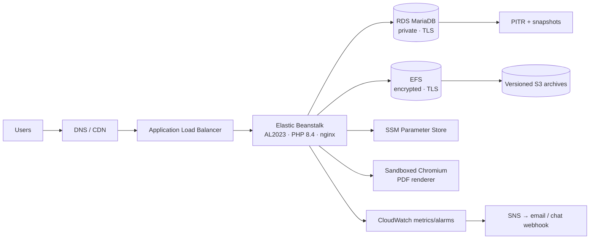

# Zero-Data-Loss Migration of a Live SaaS from a PaaS to AWS

> **Case study** · PHP / MariaDB · AWS Elastic Beanstalk · RDS · EFS · SSM · CloudWatch
>
> Persian version: [README.fa.md](README.fa.md)

**Confidentiality:** This project was delivered under a confidentiality agreement. The client, brand, domains, account identifiers, data, source code and project tools are **not** published here; they remain the client's property. Figures are rounded. Everything in [`templates/`](templates/) was written from scratch as generic material.

---

## At a glance

| | |
|---|---|
| **Client** | Live B2B SaaS: two domains, one shared codebase and database, paying customers |
| **From → To** | PaaS with a VM-local MariaDB → AWS Elastic Beanstalk + private RDS MariaDB + encrypted EFS |
| **Contract** | Fixed price, 4 milestones, each approved by the owner |
| **Duration** | ~4 weeks to acceptance, plus 14 days of defect support |
| **Data lost** | **0 records** |
| **Reconciled at cutover** | ~200 of ~200 tables · ~640k rows · issued PDFs verified by SHA-256 |
| **DNS switch** | ~4 minutes for both domains |
| **First 24 h** | 0 server (5xx) errors, all alarms healthy |
| **Outcome** | All 4 milestones accepted and paid |

---

## The problem

The application ran on a PaaS, with its database on the VM's local disk. A custom **startup-recovery mechanism** restored an older backup whenever the app was republished. This caused confirmed production data loss: new registrations disappeared, changed passwords reverted and business records rolled back. Publishing had effectively stopped, because every release risked deleting customer data.

The owner needed the live system moved to AWS with **zero data loss, full auditability and complete isolation from the old platform**.

## Approach: gates, evidence, rehearsal

| Phase | Goal | Key results |
|---|---|---|
| **1. Read-only discovery** (3 days) | Find the root cause and inventory everything, changing nothing | Root cause isolated to one startup code path · 45 ranked findings (3 P0 / 28 P1 / 14 P2) · 36 scheduler loops mapped · domain/provider matrix · DB lifecycle and timeout matrix |
| **2. Dark AWS build** (synthetic data) | A repeatable, fail-closed stack | Auto-restore removed from every startup/deploy path · config fails closed (no dev fallback) · sandboxed Chromium PDF renderer qualified · stack survives instance replacement |
| **3. Timed rehearsals** (controlled real-data copy) | Prove the cutover works twice | Frozen, hashed source · 2 of 2 full rehearsals passed · import ≈ 50 min · instance replacement < 3 min · preservation matrix 9 of 9 |
| **4. Live cutover + support** | Move production, then stabilise | Old platform fenced before the first AWS write · full reconciliation · ~4 min DNS switch · mail and jobs enabled in approved waves · 24 alarms · daily checks |

Every risky step needed the owner's **written approval**: spending, releases, data copies, config changes, credential rotation, job waves and cutover. Every message, decision and test was logged with timestamps and SHA-256 hashes of the evidence.

Details: [docs/method.md](docs/method.md) · Architecture: [docs/architecture.md](docs/architecture.md) · Challenges: [docs/challenges.md](docs/challenges.md)

## Target architecture (kept small on purpose)

No Kubernetes, no queue service, no Redis, no NAT Gateway: one instance sized from measured load.

## Principles that made it safe

1. **A normal deploy changes code only.** Restore, import, seed or reset never runs at startup, deploy or restart.
2. **Fail closed.** A wrong database, wrong mount or missing config blocks readiness. There is no silent fallback.
3. **The old writer is fenced, not just flagged.** Old processes must be proven stopped before the new system takes ownership.
4. **Unknown is unknown.** An interrupted email or API call is held for reconciliation, never blindly resent.
5. **Issued documents are immutable.** They are copied byte for byte and verified by hash, never regenerated.
6. **A live homepage is not acceptance.** Only the preservation matrix and full reconciliation count.
7. **No secrets in chat, tickets, Git or release bundles.** Values are entered without being printed, and only their type and length are checked.

## Reusable templates

| Template | Use |
|---|---|
| [findings-register.md](templates/findings-register.md) | P0/P1/P2 findings with evidence, impact and retest criteria |
| [preservation-test-matrix.md](templates/preservation-test-matrix.md) | Proves that data survives every deploy and instance replacement |
| [cutover-runbook-skeleton.md](templates/cutover-runbook-skeleton.md) | Timed cutover with gates C1–C12 |
| [go-no-go-checklist.md](templates/go-no-go-checklist.md) | Go/No-Go conditions for cutover day |
| [scheduler-job-inventory.md](templates/scheduler-job-inventory.md) | Per-job ownership, locking, alarms and rehearsal sinks |

## Skills demonstrated

`AWS Elastic Beanstalk` `EC2` `RDS MariaDB` `EFS` `S3` `ALB` `IAM` `SSM Parameter Store` `CloudWatch` `SNS` `PITR / snapshots` `mysqldump` `PHP 8.4` `nginx` `PHP-FPM` `Bash` `systemd timers` `iptables` `Chromium sandboxing` `Cloudflare DNS` `TLS` `Stripe webhooks` `SMTP/IMAP` `PowerShell` `GitHub Actions OIDC` `RPO/RTO` `runbooks` `incident response`

## Work with me

I migrate live PHP/MySQL/MariaDB applications from PaaS platforms, shared hosting or a single VPS to AWS **without losing data**. Every engagement starts with a read-only discovery and a ranked list of risks, and nothing changes without your written approval.

**Ahmad Khorsandi Pour** — Cloud Infrastructure Engineer
