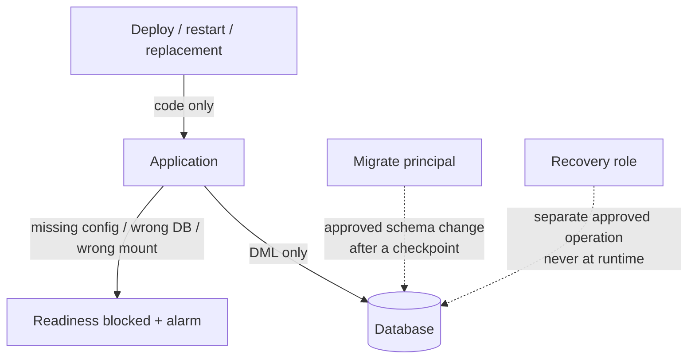
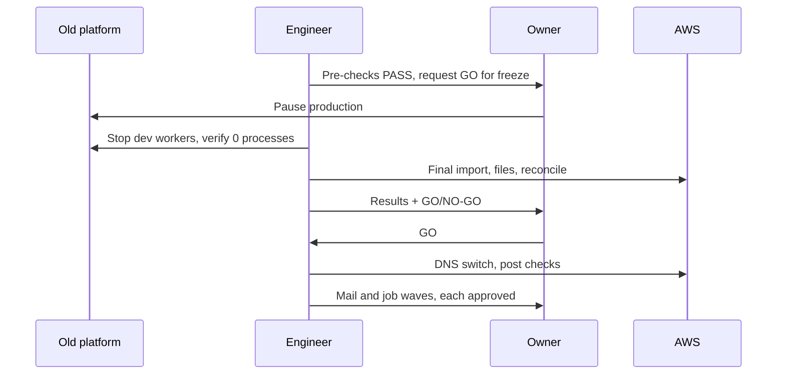

# Target architecture

| Layer | Choice | Notes |
|---|---|---|
| Compute | Elastic Beanstalk, 1 × t3.small, Amazon Linux 2023, PHP 8.4, nginx | Larger size only if measured load requires it |
| Database | RDS MariaDB, private subnets | TLS with a verified CA/hostname, encryption at rest, least-privilege grants, engine support dates checked |
| Files | EFS, encrypted, TLS mount | Mount identity verified; no ephemeral fallback; backups kept out of web paths |
| Sessions | MariaDB session handler | Exactly one documented sign-out at cutover |
| Config / secrets | SSM Parameter Store | Never bundled with releases; missing value = explicit failure |
| Deployments | Versioned bundles with a pinned config hash; GitHub Actions OIDC designed | No long-lived AWS keys; approval before every release |
| PDF | Chromium under a dedicated user, network-isolated | Max 2 concurrent renders, resource limits, issued PDFs immutable |
| Jobs | systemd timers + a shared runner wrapper | Exclusive ownership, signed evidence per run, missed-success alarms |
| Monitoring | CloudWatch alarms → SNS (email) + chat webhook | Health, 5xx, DB memory, EFS, backups, per-job success age, held outcomes |
| Backups | RDS automated backups (≥ 7 days) + pre-change snapshots + versioned S3 file archives | Recovery is a separate, approved operation |
| Domains | Host-aware nginx for two domains | HTTPS redirect, canonical host, unexpected hosts rejected |

## Data-safety layers

## Cutover fencing

